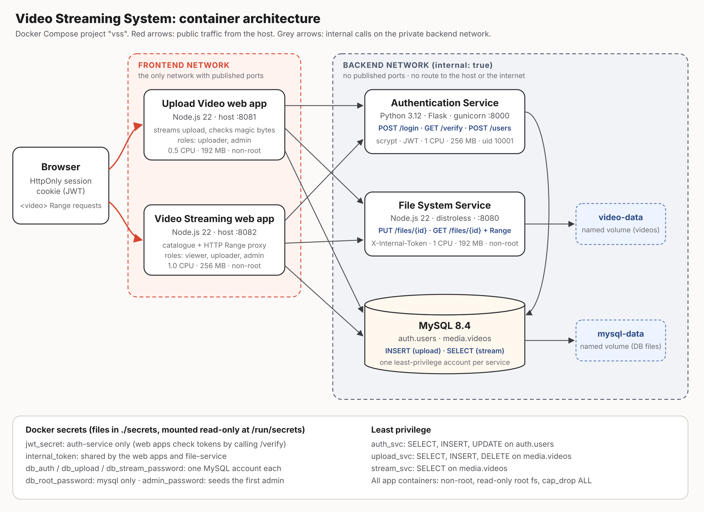

# Video Streaming System (CIT3495 Project 1, option 2)

A containerised video platform made of five services: four we wrote, in two languages (Node.js and Python), plus MySQL. Users can upload videos, and authorised users can stream them with seeking (HTTP Range).



| Service | Language | Purpose | Exposed to host |
|---|---|---|---|
| `upload-web` | Node.js 22 | Upload Video web app: login, upload (streamed, content-checked), admin user creation | **:8081** |
| `streaming-web` | Node.js 22 | Video Streaming web app: catalogue from MySQL, Range-proxied playback | **:8082** |
| `auth-service` | Python 3.12 (Flask/gunicorn) | Login, registration, JWT issue/verify, roles, brute-force lockout | no |
| `file-service` | Node.js 22 (standard library only, no dependencies) | Reads and writes video files on a persistent volume; supports Range | no |
| `mysql` | MySQL 8.4 | `auth.users`, `media.videos` | no |

The technical report with all the required evidence is in **[docs/REPORT.md](docs/REPORT.md)**.

---

## Quick start (clean machine)

Requirements: Docker Engine 24+ (or Docker Desktop) with Compose v2.20+. Nothing else needs to be installed; every test tool runs in a container.

```bash
git clone <this repo> vss && cd vss

# 1. Generate random secrets into ./secrets (git-ignored). Prints the admin password.
./scripts/init-secrets.sh --show-admin
#    Windows PowerShell: powershell -ExecutionPolicy Bypass -File scripts\init-secrets.ps1

# 2. Build and start everything; --wait blocks until every health check passes.
docker compose up -d --build --wait

# 3. Use it
#    Upload:  http://localhost:8081   (log in as admin / <printed password>)
#    Watch:   http://localhost:8082   (register a viewer account, or reuse the admin)
```

First start takes about a minute while MySQL initialises its volume. `docker compose ps` shows the health of every service.

**Stop:** `docker compose down` keeps data. `docker compose down -v` also deletes the volumes, so all videos and users are lost.

### Roles

| Role | Can stream | Can upload | Can create accounts |
|---|:-:|:-:|:-:|
| viewer (self-registration) | ✓ | | |
| uploader | ✓ | ✓ | |
| admin (seeded from `secrets/admin_password.txt`) | ✓ | ✓ | ✓ |

An admin creates uploaders from the "Admin: create an account" form on the Upload app.

---

## Troubleshooting

| Symptom | Cause | Fix |
|---|---|---|
| `bind source path does not exist: .../secrets/...` | `./secrets/` is missing; it is never in the repo or zip | Copy your existing `secrets/` folder in, or run `./scripts/init-secrets.sh` on a fresh start |
| auth-service logs `OperationalError 1045: Access denied` | The MySQL volume was created with different secrets, or the account script didn't run | `docker compose down -v` then `docker compose up -d --build --wait` (rebuilds the database) |
| mysql stays `unhealthy` | The health check requires the schema **and** all three service accounts | `docker compose logs mysql`, then `docker compose down -v` and start again |

The MySQL init scripts in `db/init/` only run on the first start of an empty volume. To re-run them, delete the volume with `docker compose down -v`.

## Evidence scripts

Each script works against the running stack and writes its output to `./results/`.

| Script | What it proves |
|---|---|
| `./scripts/e2e.sh` | Full functional flow, access control, input validation, Range streaming, and that internal services can't be reached from the frontend network or the host |
| `./scripts/persistence-test.sh` | Destroys and recreates the `mysql` and `file-service` containers, then shows users, metadata and identical video bytes survive |
| `./scripts/failure-test.sh` | Stops MySQL, stops the file service, and crashes the auth service; records what users see and how long recovery takes |
| `./scripts/loadtest.sh` | Repeatable k6 load test, with baseline and improved configurations, plus CPU and memory per container |
| `./scripts/measure-images.sh` | Image size and build time, naive vs optimised Dockerfile |
| `./scripts/scan.sh [--with-naive]` | Trivy vulnerability scan of every image |

The scripts need bash and curl (Linux, macOS, WSL or Git Bash).

---

## Configuration

Secrets are files in `./secrets/` mounted at `/run/secrets/*`. They are never stored in environment variables, the image or the repository. Non-secret settings can be overridden in a `.env` file (see `.env.example`):

| Variable | Default | Meaning |
|---|---|---|
| `UPLOAD_PORT` / `STREAM_PORT` | 8081 / 8082 | Published host ports |
| `MAX_UPLOAD_MB` | 500 | Upload size limit (enforced by upload-web and file-service) |
| `AUTH_CACHE_TTL_MS` | 30000 | How long the web apps cache a successful token verification (0 = off) |
| `HTTP_KEEPALIVE` | true | Reuse connections from the web apps to internal services |
| `READ_BUFFER_KB` | 1024 | File-service read chunk size when streaming (Node default is 64) |
| `AUTH_WORKERS` | 2 | gunicorn worker processes for the auth service |
| `COOKIE_SECURE` | false | Set to `true` when served over HTTPS |
| `REGISTRY` / `TAG` | ghcr.io/your-github-user / local | Image names used by Compose and CI |

### Running the published images instead of building

```bash
REGISTRY=ghcr.io/<owner> TAG=latest docker compose up -d --no-build --wait
```

---

## Development

Each service has unit tests that need no database:

```bash
cd services/auth-service  && python -m unittest discover -s tests -t .   # needs flask, pyjwt
cd services/file-service  && node --test
cd services/upload-web    && node --test
cd services/streaming-web && node --test
```

Each Dockerfile also has a `test` stage (`docker build --target test …`), which CI runs so the image is tested exactly as it is built.

**Lockfiles:** run `npm install --package-lock-only` in `services/upload-web` and `services/streaming-web` and commit the generated `package-lock.json` files. The Dockerfiles then switch automatically to the reproducible `npm ci`.

## CI/CD

`.github/workflows/ci.yml` runs on every push and pull request:

1. **test**: Python and Node unit tests.
2. **image** (one job per service): runs the Dockerfile test stage, builds, runs a Trivy scan (SARIF goes to the GitHub Security tab; fixable CRITICAL findings fail the build), then builds **linux/amd64 + linux/arm64** and pushes to GHCR with SBOM and provenance. Tags are `sha-<short>`, the branch name, semver on `v*` tags, and `latest` on main.
3. **e2e**: starts the whole stack with Compose and runs the e2e, persistence and failure scripts. The results are uploaded as an artifact.

Pushing needs no configuration: the workflow uses the per-run `GITHUB_TOKEN`. To make the images public, change the package visibility in GitHub → Packages.

## Repository layout

```
docker-compose.yml        complete system
db/init/                  schema + least-privilege MySQL accounts (first start only)
services/
  auth-service/           Python  - Dockerfile, gunicorn.conf.py, app/, tests/
  file-service/           Node    - Dockerfile (+ Dockerfile.naive baseline), src/, test/
  upload-web/             Node    - Dockerfile (+ Dockerfile.naive baseline), src/, public/, test/
  streaming-web/          Node    - Dockerfile, src/, public/, test/
  web-common/             shared Node code for both web apps (routing, sessions, clients, UI assets)
scripts/                  secrets + evidence scripts
tests/e2e, tests/load     smoke test (Node) and k6 load test
docs/                     architecture diagram + technical report
.github/workflows/ci.yml  pipeline
```
